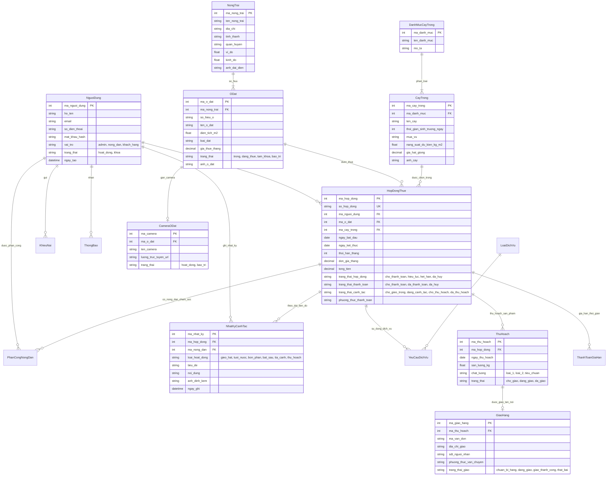

# TÀI LIỆU KỸ THUẬT & HỆ THỐNG (TECHNICAL ASSETS SPECIFICATION)
## DỰ ÁN: PLOTFARM - NỀN TẢNG CHO THUÊ Ô ĐẤT & CANH TÁC NÔNG NGHIỆP TRỰC TUYẾN
**Phụ trách:** Backend Team (Đào Đại Sơn - Phan Nguyễn Ngọc Quý)  
**Nhóm:** Group 11 (OJT FPT)  
**Mục tiêu:** Cung cấp tài liệu kỹ thuật hoàn chỉnh gồm Sơ đồ cơ sở dữ liệu (ERD), Tài liệu đặc tả API (API Documentation), Hướng dẫn tích hợp cổng thanh toán, luồng Camera trực tuyến và API quan trắc thời tiết vệ tinh để lưu trữ Google Drive (`05_Technical_Assets`).

---

# PHẦN 1: SƠ ĐỒ CƠ SỞ DỮ LIỆU & KIẾN TRÚC DỮ LIỆU (DATABASE SCHEMA & ERD)

Hệ thống cơ sở dữ liệu của PlotFarm được thiết kế trên hệ quản trị **Microsoft SQL Server (Transact-SQL)**, chuẩn hóa ở mức **3NF (Third Normal Form)**, đảm bảo toàn vẹn dữ liệu giao dịch và khả năng mở rộng cao.

### 1.1. Sơ đồ Quan hệ Thực thể (Mermaid Entity Relationship Diagram - ERD)



---

### 1.2. Bảng từ điển dữ liệu các bảng cốt lõi (Core Data Dictionary)

#### 1. Bảng `HopDongThue` (Hợp đồng thuê đất & Canh tác)
* `ma_hop_dong` (INT, PK, Identity): Mã định danh duy nhất của hợp đồng trong hệ thống.
* `so_hop_dong` (VARCHAR(50), Unique): Mã số hợp đồng hiển thị cho khách hàng (ví dụ: `HD-20261015-8832`).
* `ma_nguoi_dung` (INT, FK -> NguoiDung): Khách hàng đứng tên thuê ô đất.
* `ma_o_dat` (INT, FK -> ODat): Ô đất được thuê. Khi hợp đồng hiệu lực, trạng thái ô đất chuyển sang `dang_thue`.
* `ma_cay_trong` (INT, FK -> CayTrong): Loại nông sản khách hàng chọn trồng trên ô đất.
* `ngay_bat_dau`, `ngay_ket_thuc` (DATE): Thời hạn chu kỳ thuê.
* `thoi_han_thang` (INT): Số tháng thuê đất (1, 3, 6, 12 tháng).
* `tong_tien` (DECIMAL(18,2)): Tổng số tiền khách hàng phải thanh toán = `don_gia_thang * thoi_han_thang + chi_phi_dich_vu_ban_dau`.
* `trang_thai_hop_dong`: `cho_thanh_toan` -> `hieu_luc` -> `het_han` / `da_huy`.
* `trang_thai_thanh_toan`: `cho_thanh_toan` -> `da_thanh_toan` -> `da_huy`.
* `trang_thai_canh_tac`: `cho_gieo_trong` -> `dang_canh_tac` -> `cho_thu_hoach` -> `da_thu_hoach`.

#### 2. Bảng `ODat` (Danh mục ô đất canh tác)
* `ma_o_dat` (INT, PK): Khóa chính ô đất.
* `ma_nong_trai` (INT, FK -> NongTrai): Thuộc nông trại quản lý.
* `so_hieu_o` (VARCHAR(20), Unique): Ký hiệu ô đất (A-01, B-05, C-02...).
* `dien_tich_m2` (FLOAT): Diện tích thực tế ô đất (20 m² - 100 m²).
* `loai_dat` (NVARCHAR(100)): Tính chất thổ nhưỡng của đất.
* `gia_thue_thang` (DECIMAL(18,2)): Đơn giá cho thuê mỗi tháng.
* `trang_thai`: `trong` (sẵn sàng cho thuê), `dang_thue` (đang có khách canh tác), `tam_khoa`, `bao_tri`.

---

# PHẦN 2: TÀI LIỆU ĐẶC TẢ API HỆ THỐNG (PLOTFARM RESTFUL API SPECIFICATION)

### 2.1. Chuẩn giao thức & Headers
* **Giao thức:** HTTPS RESTful API, chuẩn trao đổi dữ liệu: `application/json; charset=utf-8`.
* **Cơ chế xác thực (Authentication):** JSON Web Token (JWT).
  * Header bắt buộc cho các API bảo mật: `Authorization: Bearer <access_token>`
* **Cấu trúc Response tiêu chuẩn:**
```json
{
  "success": true,
  "data": { ... },
  "message": "Thông báo trạng thái thành công"
}
```

---

### 2.2. Danh mục chi tiết các Modules API

#### Module 1: Xác thực & Người dùng (`/api/auth`)
| Method | Endpoint | Yêu cầu xác thực | Mô tả chức năng |
| :--- | :--- | :--- | :--- |
| `POST` | `/api/auth/register` | Public | Đăng ký tài khoản khách hàng mới (họ tên, email, sđt, mật khẩu). |
| `POST` | `/api/auth/login` | Public | Đăng nhập hệ thống, trả về JWT Access Token và thông tin vai trò. |
| `GET` | `/api/auth/me` | Bearer Token | Lấy thông tin tài khoản cá nhân của người đang đăng nhập. |
| `PATCH`| `/api/auth/me` | Bearer Token | Cập nhật hồ sơ cá nhân (sđt, địa chỉ nhận rau, ảnh đại diện). |

#### Module 2: Quản lý Ô đất (`/api/plots`)
| Method | Endpoint | Yêu cầu xác thực | Mô tả chức năng |
| :--- | :--- | :--- | :--- |
| `GET` | `/api/plots/available` | Public | Lấy danh sách các ô đất còn trống (`trang_thai = 'trong'`) để hiển thị cho thuê. |
| `GET` | `/api/plots/:idOrCode` | Public | Lấy thông tin chi tiết một ô đất (diện tích, giá thuê, loại đất, hình ảnh, camera). |
| `PATCH`| `/api/plots/:id/status`| Admin/Farmer | Cập nhật trạng thái bảo trì hoặc khóa ô đất. |

#### Module 3: Danh mục Cây trồng (`/api/crops`)
| Method | Endpoint | Yêu cầu xác thực | Mô tả chức năng |
| :--- | :--- | :--- | :--- |
| `GET` | `/api/crops` | Public | Lấy toàn bộ danh sách hạt giống / cây trồng hỗ trợ (thời gian lớn, năng suất, mùa vụ). |
| `GET` | `/api/crops/:id` | Public | Xem chi tiết quy trình canh tác và giá hạt giống của loại cây. |

#### Module 4: Hợp đồng Thuê đất & Canh tác (`/api/rentals`)
| Method | Endpoint | Yêu cầu xác thực | Mô tả chức năng |
| :--- | :--- | :--- | :--- |
| `POST` | `/api/rentals` | Khách hàng | Tạo đơn đặt thuê ô đất mới, tự động khóa ô đất và tạo thông tin VietQR thanh toán. |
| `GET` | `/api/rentals/active` | Bearer Token | Lấy danh sách các hợp đồng đang hoạt động của người dùng. |
| `GET` | `/api/rentals/:id` | Bearer Token | Xem chi tiết một hợp đồng thuê (thông tin ô đất, cây trồng, tiến độ, nhật ký). |
| `GET` | `/api/rentals/:id/payment-info` | Khách hàng | Lấy thông tin thanh toán ngân hàng và mã VietQR động theo mã hợp đồng. |
| `POST` | `/api/rentals/:id/confirm-payment` | Khách hàng/Admin| Xác nhận thanh toán hợp đồng -> chuyển sang hiệu lực & kích hoạt canh tác. |
| `POST` | `/api/rentals/:id/extend` | Khách hàng | Đăng ký gia hạn thuê ô đất thêm 1, 3, 6 tháng và sinh mã QR gia hạn. |
| `POST` | `/api/rentals/:id/new-crop` | Khách hàng | Đăng ký đổi loại cây trồng cho vụ mùa tiếp theo sau khi đã thu hoạch. |
| `POST` | `/api/rentals/:id/cancel` | Khách hàng | Yêu cầu hủy hợp đồng trước hạn. |

#### Module 5: Nhật ký canh tác Nông trại (`/api/journal`)
| Method | Endpoint | Yêu cầu xác thực | Mô tả chức năng |
| :--- | :--- | :--- | :--- |
| `GET` | `/api/journal/rental/:rentalId` | Khách hàng/Nông dân | Lấy dòng thời gian nhật ký chăm sóc ô đất (tưới nước, bón phân, tỉa cành, hình ảnh). |
| `POST` | `/api/journal` | Nông dân | Nông dân chụp ảnh thực địa và cập nhật bài viết nhật ký cho ô đất phụ trách. |
| `PATCH`| `/api/journal/:id` | Nông dân | Chỉnh sửa nội dung nhật ký đã đăng. |

#### Module 6: Thu hoạch & Giao hàng (`/api/harvest`)
| Method | Endpoint | Yêu cầu xác thực | Mô tả chức năng |
| :--- | :--- | :--- | :--- |
| `GET` | `/api/harvest/rental/:rentalId` | Bearer Token | Xem lịch sử thu hoạch và sản lượng nông sản của ô đất. |
| `POST` | `/api/harvest/ready` | Nông dân/Admin | Báo cáo nông sản đã chín tới ngày thu hoạch, thông báo cho khách hàng. |
| `POST` | `/api/harvest/delivery` | Khách hàng | Khách hàng tạo yêu cầu đóng gói và giao rau củ về địa chỉ nhà. |
| `PATCH`| `/api/rentals/harvest-deliveries/:id/handover` | Nông dân/Admin | Bàn giao đơn hàng cho đơn vị vận chuyển (shipper) và cập nhật mã vận đơn. |

#### Module 7: Camera Giám sát Ô đất 24/7 (`/api/camera`)
| Method | Endpoint | Yêu cầu xác thực | Mô tả chức năng |
| :--- | :--- | :--- | :--- |
| `GET` | `/api/camera/stream/:plotId` | Public/Auth | Lấy luồng phát trực tiếp (HLS `.m3u8` hoặc luồng stream mô phỏng) của ô đất. |
| `GET` | `/api/camera/plot/:plotId` | Public/Auth | Lấy thông tin trạng thái hoạt động của thiết bị camera tại ô đất. |

#### Module 8: Trạm Thời tiết Vệ tinh & Khí tượng (`/api/weather`)
| Method | Endpoint | Yêu cầu xác thực | Mô tả chức năng |
| :--- | :--- | :--- | :--- |
| `GET` | `/api/weather/current` | Public | Lấy dữ liệu thời tiết thực tế từ vệ tinh Open-Meteo theo tọa độ GPS nông trại. |
| `GET` | `/api/weather/yield-estimate` | Public | Ước tính ảnh hưởng thời tiết thực tế đến tốc độ phát triển và năng suất cây. |

#### Module 9: Quản trị & Điều hành (`/api/admin`)
| Method | Endpoint | Yêu cầu xác thực | Mô tả chức năng |
| :--- | :--- | :--- | :--- |
| `GET` | `/api/admin/dashboard` | Admin | Lấy số liệu KPI tổng quan: Doanh thu, số ô đất đang thuê, tỷ lệ lấp đầy, số nông dân. |
| `GET` | `/api/admin/users` | Admin | Quản lý danh sách người dùng, cấp quyền hoặc khóa tài khoản. |
| `GET` | `/api/admin/payments` | Admin | Danh sách các khoản thanh toán chờ duyệt hoặc cần đối soát. |
| `PATCH`| `/api/admin/payments/:kind/:id/approve` | Admin | Duyệt khoản thanh toán thủ công. |
| `POST` | `/api/admin/assignments` | Admin | Phân công nông dân chịu trách nhiệm chăm sóc ô đất theo hợp đồng. |

---

# PHẦN 3: TÀI LIỆU TÍCH HỢP HỆ THỐNG (INTEGRATION SPECIFICATIONS)

### 3.1. Tích hợp Cổng thanh toán Chuyển khoản VietQR & Ngân hàng 24/7
Hệ thống sử dụng cơ chế thanh toán **VietQR chuẩn quốc gia NAPAS** kết hợp đối soát mã hợp đồng thông minh:

1. **Thuật toán sinh mã QR động:**
   * Ngân hàng thụ hưởng: `Vietcombank` (Ngân hàng TMCP Ngoại thương Việt Nam)
   * Số tài khoản nông trại: `9988776655`
   * Cú pháp chuyển khoản định danh: `PF<Mã_Hợp_Đồng>` (Ví dụ: `PFHD202610158832`)
   * Số tiền: Đúng bằng giá trị `tong_tien` trên hợp đồng.
   * Định dạng link QR Code chuẩn:
     ```text
     https://api.vietqr.io/image/970436-9988776655-compact.png?amount={amount}&addInfo={transfer_content}&accountName={account_name}
     ```
2. **Luồng xử lý trạng thái giao dịch (State Machine):**
   ```text
   [Khách chọn ô đất & tạo hợp đồng]
                 │
                 ▼
   [Hợp đồng: cho_thanh_toan] ──(Khách quét mã VietQR và xác nhận)──► [Xác nhận thanh toán]
                 │                                                          │
                 ▼ (Quá 24h không thanh toán)                               ▼
           [Hủy đơn & nhả ô đất]                             [Hợp đồng: hieu_luc]
                                                             [Ô đất: dang_thue]
                                                             [Phân công Nông dân gieo hạt]
   ```

---

### 3.2. Tích hợp Camera Giám Sát Ô Đất Trực Tiếp 24/7 (IoT Video Streaming)
* **Kiến trúc luồng phát:**
  * Camera IP ngoài trời hỗ trợ giao thức `RTSP` (Real-Time Streaming Protocol).
  * Video Streaming Gateway chuyển đổi luồng RTSP sang định dạng **HLS (HTTP Live Streaming - `.m3u8`)** để phát trực tiếp mượt mà trên mọi trình duyệt web (Chrome, Safari iOS, Edge) mà không cần cài plugin.
* **Cơ chế dự phòng (Failover / Simulation Engine):**
  * Khi camera thực tế tại hiện trường gặp sự cố đứt mạng hoặc mất nguồn, hệ thống tự động nhận diện và chuyển hướng mượt sang luồng mô phỏng chất lượng cao (`is_simulated: true`), giữ trải nghiệm người dùng không bị gián đoạn.

---

### 3.3. Tích hợp Dữ liệu Thời tiết Vệ tinh Thực tế (Open-Meteo Satellite Realtime API)
* **Đặc tính kỹ thuật:**
  * Không phụ thuộc hardcode; kết nối trực tiếp trạm vệ tinh khí tượng Open-Meteo theo tọa độ GPS chính xác của nông trại từ bảng `NongTrai`: `latitude=15.9628`, `longitude=108.1824`.
  * Endpoint truy vấn:
    ```text
    https://api.open-meteo.com/v1/forecast?latitude=15.9628&longitude=108.1824&current=temperature_2m,relative_humidity_2m,weather_code,wind_speed_10m,uv_index&daily=temperature_2m_max,temperature_2m_min,weather_code&timezone=Asia%2FBangkok
    ```
* **Bảng ánh xạ mã thời tiết WMO (World Meteorological Organization):**
  * `0`: Trời trong xanh, nắng đẹp (`☀️`)
  * `1, 2, 3`: Nắng nhẹ xen mây, râm mát (`⛅`)
  * `45, 48`: Sương mù nhẹ rạng sáng (`🌫️`)
  * `51 - 82`: Có mưa rào / mưa giông rải rác (`🌧️`)
  * `95 - 99`: Giông sét, mưa lớn nguy cơ ngập úng (`⛈️`)
* **Hệ thống phân tích nông nghiệp thông minh (Smart Agro-Advisory):**
  * Tự động tính toán lượng nước bốc hơi dựa trên nhiệt độ và độ ẩm, đưa ra khuyến nghị thời điểm tưới nước tối ưu (chiều mát sau 16h30 nếu trời nắng gắt, hoặc tự động ngắt van tưới nếu trời mưa lớn) giúp bảo vệ rễ cây và tiết kiệm tài nguyên.
